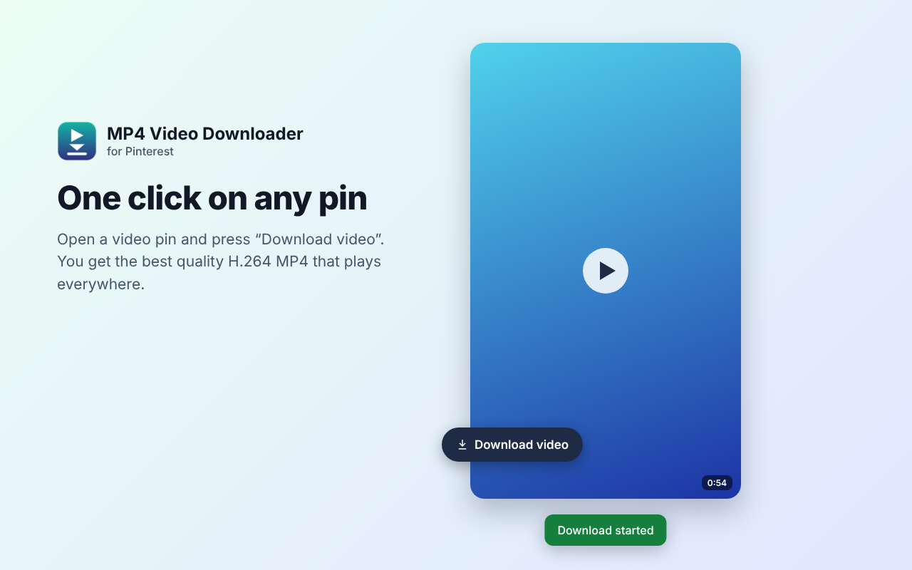

# MP4 Video Downloader for Pinterest

A Chrome extension (Manifest V3) that downloads Pinterest videos as **MP4** files.



## Features

- **Download video** button on every video pin page.
- **MP4** button on videos in the feed, search results and related pins.
- Toolbar popup: shows the video on the current pin, or paste any `pinterest.com/pin/…` or `pin.it/…` link.
- Right-click menu on pin links: *Download Pinterest video (MP4)*.
- Idea pins with several clips: download one or all.
- Picks the best H.264 + AAC MP4 (plays everywhere); falls back to deriving the MP4 from the stream if the pin only lists HLS.
- Clean file names from the pin title (hashtags/emoji removed), optional `Pinterest/` subfolder and "ask where to save".
- No servers, no analytics, no remote code. See the [privacy policy](docs/privacy-policy.md).

## Install for testing

1. Open `chrome://extensions` and enable **Developer mode**.
2. Click **Load unpacked** and select the `extension/` folder.
3. Open a Pinterest video pin and click **Download video**.

## Publish to the Chrome Web Store

See **[PUBLISHING.md](PUBLISHING.md)** for the step-by-step guide and **[store/listing.md](store/listing.md)** for all the text to paste. The upload file is `dist/pinterest-mp4-downloader-<version>.zip`.

## How it works

1. The pin ID is taken from the page URL or link (`/pin/<id>/`, `/pin/<slug>--<id>/`, or a `pin.it` short link, which is expanded).
2. The pin's data is requested from Pinterest's own web API (`/resource/PinResource/get/`). From the content script this runs with the user's Pinterest session, so pins visible to the user work too.
3. Every `video_list` in the pin (regular videos, idea pin pages, carousels) is collected. If the API fails, video URLs are pulled from the pin page HTML instead.
4. For each clip, the best H.264 MP4 is chosen (`V_720P`, `V_EXP*` …). If only an HLS stream is listed, the matching `/720p/…mp4` is derived and checked with a `HEAD` request. HEVC files are the last resort.
5. `chrome.downloads` saves the file.

## Project layout

```
extension/            ← the extension (this folder is what gets zipped)
  manifest.json
  background.js       service worker: resolve pins, start downloads, context menu
  lib/resolver.js     pin ID parsing, Pinterest API/HTML parsing, quality ranking, file names
  content/            in-page buttons and toast on Pinterest
  popup/              toolbar popup
  icons/
store/                Web Store images + listing text
docs/                 privacy policy (for GitHub Pages)
scripts/              package.sh (build ZIP), icon and store-image generators
tests/                unit tests (node --test)
```

## Development

```bash
npm test                 # unit tests (Node 18+)
./scripts/package.sh     # build dist/pinterest-mp4-downloader-<version>.zip
python3 scripts/make_icons.py extension/icons   # regenerate icons (Pillow)
node scripts/make_store_assets.js               # regenerate store images (Playwright)
```

## Disclaimer

This extension is not affiliated with, endorsed or sponsored by Pinterest, Inc. Download only videos you own or have permission to save.
